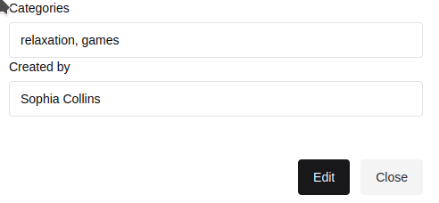

# Feedback

## Jordy from Winc Academy, 23/11/26

Beste Patrick,

- [x] Momenteel ontbreekt in het formulier nog **wie jou heeft ondersteund bij het project** en **op welke manier je AI hebt gebruikt.**

    > Ik maakte een foute keuze bij de ondersteun vraag. Die had ik namelijk niet. En mijn AI gebruik staat in [COPILOT.md](COPILOT.md).

- [x] De **skeletons** in jouw project komen niet overeen met de uiteindelijke content.

    

    Zodra jouw project inlaadt verschijnen er vier vierkante **skeletons** in beeld. Zodra het laden klaar is dan ziet er paginalay-out er heel anders uit dan deze vier vierkanten.

    > De breedte overgenomen van EventCard voor de placeholders tijdens laden.
    >
    > - [x] Filter gedeelte een apart component
    > - [x] Filter ook in het skeleton gezet
    > - [x] Iiteindelijke vorm beter nagebouwd

- [x] Het zou beter zijn als alle cards dezelfde breedte hebben. Nu is de card breedte afhankelijk van de afbeelding.

    > Ik heb de card.root en image een vaste breedtes gegeven.

- [x] Na het aanpassen van een event veranderen de checkboxes voor de categorieën in een tekstveld met vrije invoer.

    |Afb. 1|Afb. 2|
    |-|-|
    |||

    Zodra je de data opslaat en opnieuw inlaadt zal React opnieuw een render uitvoeren. Dit is echter alleen van toepassing zodra de waarde van de data veranderd.

    > :white_check_mark: Ik heb gekozen om na het opslaan om het dialoog te sluiten. Was ten eerste verwarrend en ten tweede lost het problemen op.

- [ ] Daarnaast wordt de afbeelding na het aanpassen en opslaan nog niet direct bijgewerkt.

    Je kunt dit oplossen door een key={event.image} mee te geven aan de afbeelding in de EventCard en de EventPage.

- [x] Mooi dat je een melding toont wanneer er geen event gevonden kan worden via de zoekfunctie.

    > Thx!

Mocht je ergens hulp bij nodig hebben dan zijn we bereikbaar via de question_ channels op Slack. Reacties op dit bericht zijn niet zichtbaar voor docenten.

Met vriendelijke groet,

Namens het Winc docenten-team,
