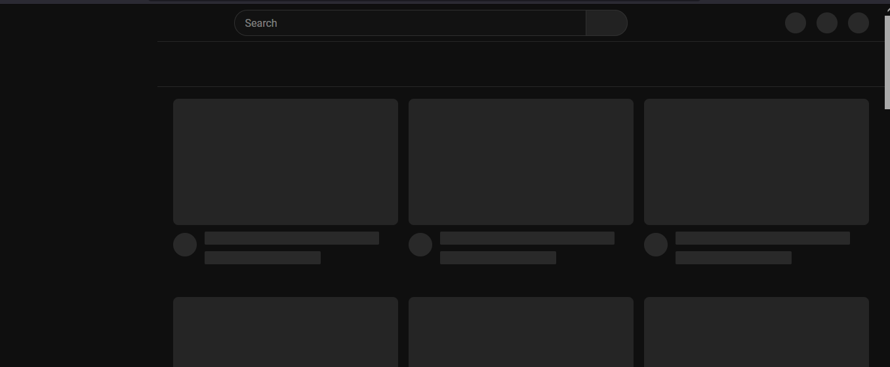
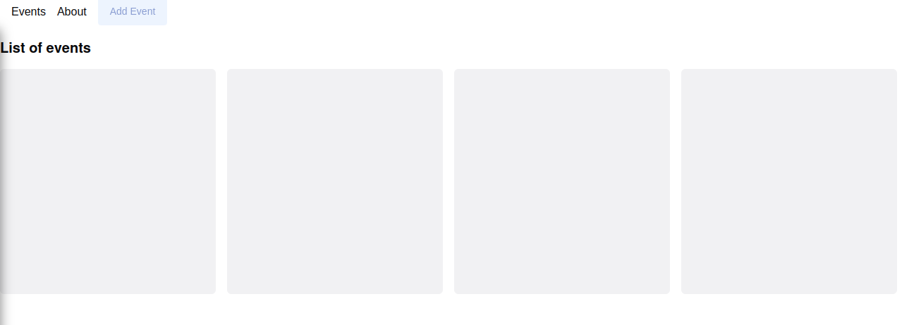
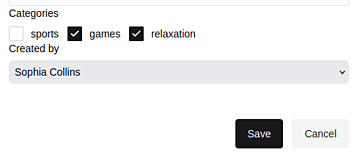

# Feedback

## Jordy via Slack, 24-11-26

De skeletons zien er goed uit op de homepage. Ditzelfde kun je ook toepassen op de event detail pagina.

Twee optionele verbeterpunten:
- Na het aanpassen van een event kom je op de homepage uit, het liefst wil je als gebruiker gelijk de aanpassingen kunnen zien op de event detail pagina.
- De witruimte tussen de cards kan kleiner gemaakt worden, hierdoor passen er meer cards op het scherm. Je zou de cards eventueel ook breder kunnen maken.

De categories worden nog niet geheel opgevraagd via de JSON-server API. Tijdens het laden staan hier de “sports, games, relaxation”, maar zodra het laden klaar is veranderen deze in de items die mijn JSON-server aanlevert.

> het is voorbeeld voor de skeleton want we waren nog aan het laden…

Dan kun je hier het beste ook een skeleton voor gebruiken.

> ik zal het proberen
>
> hoop gedoe voor iets wat je vaak vluchtig ziet hoor

Dat klopt ja, maar als je een website bouwt dan moet je altijd rekening houden met gebruikers die misschien niet zo’n snelle internetverbinding hebben, bijvoorbeeld bij slecht mobiel bereik.
Met het gebruik van skeletons zien gebruikers tijdens het laden wat de inhoud van de pagina gaat worden en verspringt de pagina ook niet zodra het laden klaar is.

Wat overigens ook kan gebeuren is dat de back-end API overbelast raakt omdat er veel gebruikers op de website zijn, in dat geval wil je ook dat gebruikers zien dat de pagina nog aan het laden is.

Grote websites zoals YouTube gebruiken overigens ook skeletons.
 


> Ik ben op [Skeleton | Chakra UI](https://www.chakra-ui.com/docs/components/skeleton) ook aan het kijken hoe ik een paar ‘tekstje’ achter checkboxen krijg maar het geeft nog niet het gewenste resultaat
>
> Ik heb een probeersel gepushed

Het makkelijkste is om isLoading door te sturen naar jouw EventSearchFilters component:
```js
  if (isLoading) {
    return (
      <Box p={{ base: "4", md: "6" }}>

        {/* Search and filter skeletons */}
        <EventSearchFilters
          searchText={searchText}
          categories={[
            { id: 1, name: "sports" },
            { id: 2, name: "games" },
            { id: 3, name: "relaxation" },
          ]}
          selectedCategoryIds={[]}
          isLoading={true}
        />
```

Het EventSearchFilter component komt er dan als volgt uit te zien:

```js
import {
  Box,
  Button,
  Checkbox,
  Field,
  Input,
  Text,
  Skeleton,
} from "@chakra-ui/react";

export const EventSearchFilters = ({
  searchText,
  categories,
  selectedCategoryIds,
  onSearchTextChange,
  onToggleCategory,
  onClearFilters,
  isLoading = false,
}) => (
  <Box mb="6" display="grid" gap="4">
    <Field.Root>
      <Field.Label>Search events by title</Field.Label>

      <Skeleton loading={isLoading} w="full">
        <Input
          type="search"
          value={searchText}
          onChange={(changeEvent) =>
            onSearchTextChange(changeEvent.target.value)
          }
          placeholder="Search events"
          disabled={isLoading}
        />
      </Skeleton>
    </Field.Root>
```

Je kunt ook de gehele checkboxes zelf weglaten en vervangen door een smal skeleton item. Je weet namelijk in de front-end code nog niet hoeveel checkboxes er aanwezig zijn in de back-end.

## Jordy from Winc Academy, 23/11/26

Beste Patrick,

- [x] Momenteel ontbreekt in het formulier nog **wie jou heeft ondersteund bij het project** en **op welke manier je AI hebt gebruikt.**

    > Ik maakte een foute keuze bij de ondersteun vraag. Die had ik namelijk niet. En mijn AI gebruik staat in [COPILOT.md](COPILOT.md).

- [x] De **skeletons** in jouw project komen niet overeen met de uiteindelijke content.

    

    Zodra jouw project inlaadt verschijnen er vier vierkante **skeletons** in beeld. Zodra het laden klaar is dan ziet er paginalay-out er heel anders uit dan deze vier vierkanten.

    > De breedte overgenomen van EventCard voor de placeholders tijdens laden.
    >
    > - [x] Filter gedeelte een apart component
    > - [x] Filter ook in het skeleton gezet
    > - [x] Iiteindelijke vorm beter nagebouwd

- [x] Het zou beter zijn als alle cards dezelfde breedte hebben. Nu is de card breedte afhankelijk van de afbeelding.

    > Ik heb de card.root en image een vaste breedtes gegeven.

- [x] Na het aanpassen van een event veranderen de checkboxes voor de categorieën in een tekstveld met vrije invoer.

    |Afb. 1|Afb. 2|
    |-|-|
    |||

    Zodra je de data opslaat en opnieuw inlaadt zal React opnieuw een render uitvoeren. Dit is echter alleen van toepassing zodra de waarde van de data veranderd.

    > :white_check_mark: Ik heb gekozen om na het opslaan om het dialoog te sluiten. Was ten eerste verwarrend en ten tweede lost het problemen op.

- [ ] Daarnaast wordt de afbeelding na het aanpassen en opslaan nog niet direct bijgewerkt.

    Je kunt dit oplossen door een key={event.image} mee te geven aan de afbeelding in de EventCard en de EventPage.

- [x] Mooi dat je een melding toont wanneer er geen event gevonden kan worden via de zoekfunctie.

    > Thx!

Mocht je ergens hulp bij nodig hebben dan zijn we bereikbaar via de question_ channels op Slack. Reacties op dit bericht zijn niet zichtbaar voor docenten.

Met vriendelijke groet,

Namens het Winc docenten-team,
