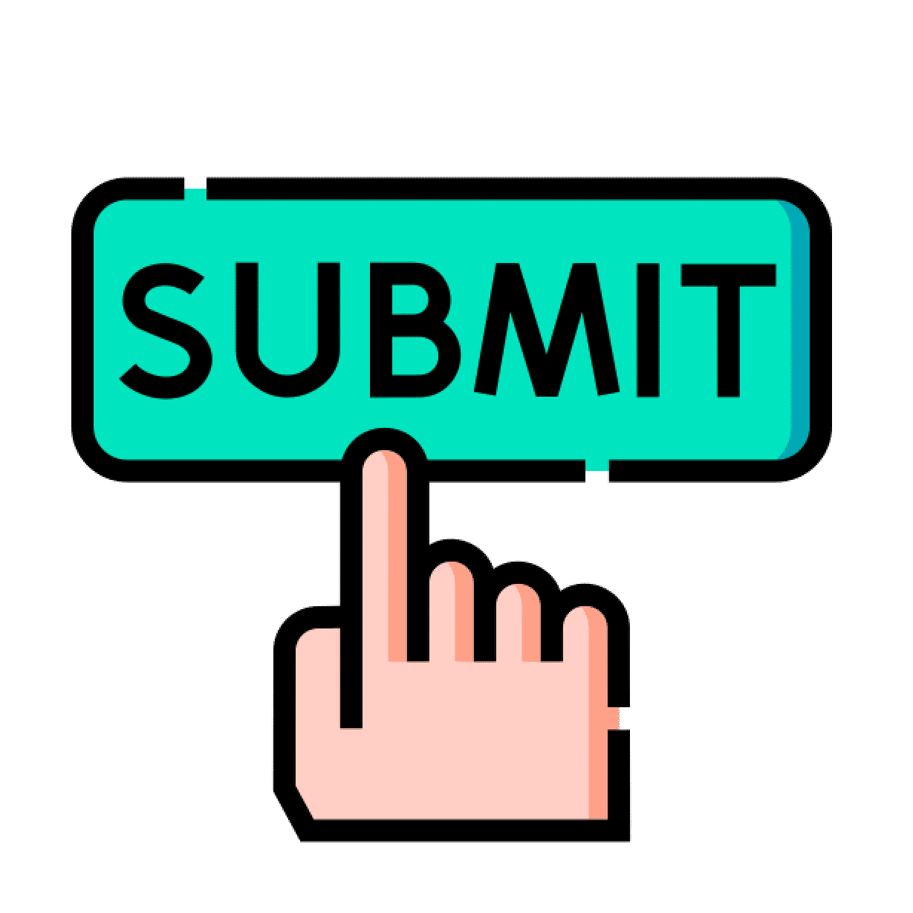

*Item 2 of 2*

## Project

<div align=center style="color:white;background-color:hsl(211, 44%, 20%);font-size:2rem;font-weight:1;padding:1rem">

This final React project wraps up the module and gives you a chance to apply everything you've learned.</div>

### Description

In this project, you are going to put everything that you have learned in the React modules into one single final project!

For this project, we would like you to create an **event management app**. The theme is up to you, but in our starter JSON file, we have added a few examples, so you have an idea of what the data structure should look like.

In short, the event management app should display a 1) list of events, 2) a modal for the creation of new events, 2) another model for the editing of existing events, 3) an option to delete events, and 4) the capability to show a detailed page of specific events. We will describe the required features in more detail below.

### Instructions

- [ ] If you use AI tools during this assignment, keep track of how and where you use them. You will be required to complete the [Project Submission Form](https://link.wincacademy.com/project-submission-form/) upon submission.
You can review the form [here](https://link.wincacademy.com/project-submission-form/) to see what information will be requested.

- [ ] Download the project template [directly as a ZIP file](https://github.com/WincAcademy/fed-react-advanced/raw/refs/heads/main/templates/project-template/project-template.zip) or clone it from [GitHub](https://github.com/WincAcademy/fed-react-advanced/tree/main/templates/project-template).<br>
The project template already has ChakraUI and React Router installed. It also has some basic components for you to start with. While ChakraUI is already installed, you are free to use another design system if you wish so — you are **required** to use a design system for this project.

- [ ] We will be using JSON server for our back-end. You can download the following [JSON file](https://github.com/WincAcademy/fe-react-advanced/blob/main/backend_data/events.json) to run the server. Run the server by going to the directory that contains your JSON file using the terminal and enter the following command:

    ```sh
    json-server events.json
    ```
- [ ] Start by inspecting the different files, components and data structure.

#### Events list page

- [ ] We would like to display **a list of all events** in `<EventsPage/>`. The events can be retrieved by making a  GET request to the JSON server at <http://localhost:3000/events>

- [ ] Add the following details when displaying an event: `title`, `description`, `image`, `startTime` & `endTime`, `categories` (using the actual names of the categories).<br>
The categories can be fetched by making a GET request to the JSON server at <http://localhost:3000/categories> and comparing the event's `categoryIds` with the ids of the fetched categories.

- [ ] Make an event item `clickable` that leads the user to a separate event page by using React Router.

- [ ] Use the *Add Event* navigation item to **open a modal/pop-up** where the user can add a new event by filling in a form.

    The user should be able to fill in the title, description, specify an image, specify a start- and end time and the categories (one or multiple). Optionally, use a form library for this.

    Connect the add event feature with the back-end, so that new events get uploaded to the server as well.

- [ ] Add a **search function**. We want a way for users to search for specific events on the page that displays all the events.

- [ ] Add a **filter function**. We need a feature that lets users filter the displayed results based on different categories. Preferably, the user can select multiple categories using e.g. checkboxes.

#### Event page

- [ ] In the `<EventPage />` component, show the following details on the screen: `title`, `description`, `image`, `location`, `startTime`, `endTime` and the `categories` (once again, using the actual names of the categories).

- [ ] Add an *Edit Event* button that allows the user to **edit the details shown on the page**. Use a modal/pop-up for this, containing a form to edit the data. Update the data on the server after saving newly made edits.

- [ ] Add a *Delete Event* button that allows the user to **delete the event**.

- [ ] Add an **extra check and warning** (e.g. yes/no dialog) to make sure that the user is 100% sure they want to delete the event. Sent a delete request to the server after confirmation and redirect the user back to the events page

#### In general

- [ ] The usage of a Context and Context.Provider is **mandatory**. Use the Context for storing the events and categories data so you can easily use it across your project.

- [ ] The usage of a design system is **mandatory**.<br>
    The implementation of dark mode is **not mandatory**.<br>
    The usage of a form or state management library is **not mandatory**, but could be nice as an extra challenge!<br>

- [ ] Whenever you add, edit or delete events, always show a message on success or on failure. This can be done e.g. in the form of a [toast](https://chakra-ui.com/docs/components/toast) notification. So for example, when deleting an event, show a notification saying if the deletion was successful or failed.

- [ ] All input fields of all forms should have `required` tags.

- [ ] Add a third page, such as an *About Us* or *Contact* page. To access this page, add another link to the `<Navigation />` component which routes to this page using React Router.<br>
The page does not have to functionally work, but can just simply show some text saying that *"This page is currently under construction"*.<br>
As an extra challenge, try to create an actual functioning page!

### Requirements

- The app makes use of **Context** and **Context.Provider**.

- The app makes use of **React Router** for navigation between the three pages (events, event details and a third page of your choosing).

- The app makes use of a **design system** like ChakraUI.

- The app is **responsive** and is accessible on both mobile and desktop.

- All input fields of all forms have `required` tags.

- Whenever events are manipulated (creating new events, updating or deleting existing events) a success or failure message is shown to the user, preferably using [toast](https://chakra-ui.com/docs/components/toast) notifications.

- Show **UI skeleton** placeholders while the events are loading.

#### Events List Page

- The events list page **shows a list of all events** that are retrieved from the back-end server with the following details: `title`, `description`, `image`, `startTime`, `endTime` and the categories (using the actual names of the categories).

- The user **can click on any event**, which leads them to the event page using React Router.

- There is a button in the navigation header that allows the user to **add new events** using a form. 

- The user can **search through the events** based on the name of the event.

- The user can **filter through the list/search results** based on a set of selected categories.

#### Event Page

- The event page shows the following details: `title`, `description`, `image`, `startTime`, `endTime` and the categories (using the actual names of the categories).

- The user can click on an edit button where they can edit the details shown on the page using a modal and a form.

- You can click on a delete button to delete the event. After deleting an event, you get redirected to the events list page.

#### Tips

- Don't forget to take regular breaks.

- You can use code examples from previous exercises and projects.

- The app is relatively simple and you are not expecting a million users, so you don't necessarily have to set up a complex state management solution.
Simply sending a (new) query to the back-end when rendering, for example, the event list to retrieve the data, is sufficient. There is no need to keep track of the data in a state that you update when editing or deleting an event.

**Well done!**

🎉 

## Grow

Great job! That was your final React project. You have learned a lot about HTML, CSS, JavaScript & React and are now able to create your own web applications! 

As a bonus, we have added one more lesson about deploying your app online.

##  How to submit your project?

Once you've completed your assignment, you can submit your project by uploading the completed Project Submission Form on the next page.

Now, follow the instruction below. 

1. **Download** the [Project Submission Form](https://link.wincacademy.com/project-submission-form/)

2. **Fill it in** (include the URL of your main GitHub repository containing your project code).

3. **Save** the completed form on your computer.

4. Go to the upload page:

    - Close this module and click **Next, or**

    - [Click here to go directly to the upload page.](https://learn.wincacademy.com/en/channels/15692/learnlists/react-advanced-2-0/items/submit-your-winc-event-app-project-here)

5. Scroll down to the **file upload** section.

6. **Upload your completed Project Submission Form.**

7. Complete the “Tell us what you think” section.

**You're done!**

Now, submit your project for review on the next step!

---

## Submit your Winc Event App project here

*Project • < 5 mins*

*Marks as complete when the exercise has been reviewed*

### Winc Event App project (React Advanced)

Submit your completed [Project Submission Form](https://link.wincacademy.com/project-submission-form/) below.

⚠️ If you receive feedback from a mentor and need to make changes, please avoid responding to their message with a comment. Instead, resubmit your project to ensure that the mentors receive a resubmission notification.

Please make sure your project meets all requirements listed on the project page and that your submission form is filled in completely. This gives us the information we need to review your work properly. If the form is incomplete, or if the project still has errors, broken features, or usability issues, we may ask you to address those first before grading the submission.

**Quick checklist before submission:**

- **Responsive design**

    Is the layout mobile-first and optimized for all screen sizes (e.g., no horizontal scrolling)?

- **Editing an event**

    Are all event details editable and pre-filled in the edit event form?<br>
    Are success or failure messages displayed after submission?

- **Search and filter**

    Is it possible to search events by title and filter events with a dropdown or checkboxes based on the category?

- **Deleting an event**

    Is there a confirmation dialog to prevent accidental deletions (preferably a React modal)?<br>
    After deleting an event, is the user redirected to the Events page?

- **Verify that no browser console warnings or errors appear, such as:**

    Warning: `validateDOMNesting(...)`: `<h2>` cannot appear as a descendant of `<p>`.

- **Optional features**

    Validate input fields (e.g. required fields, valid dates).<br>
    Make searches case-insensitive.<br>
    Handle empty search results gracefully (e.g. "No events found").
 

**Upload your completed Project Submission Form**

**If this is a redo and you didn’t change anything in the form, you can paste your GitHub link here instead:**

---
